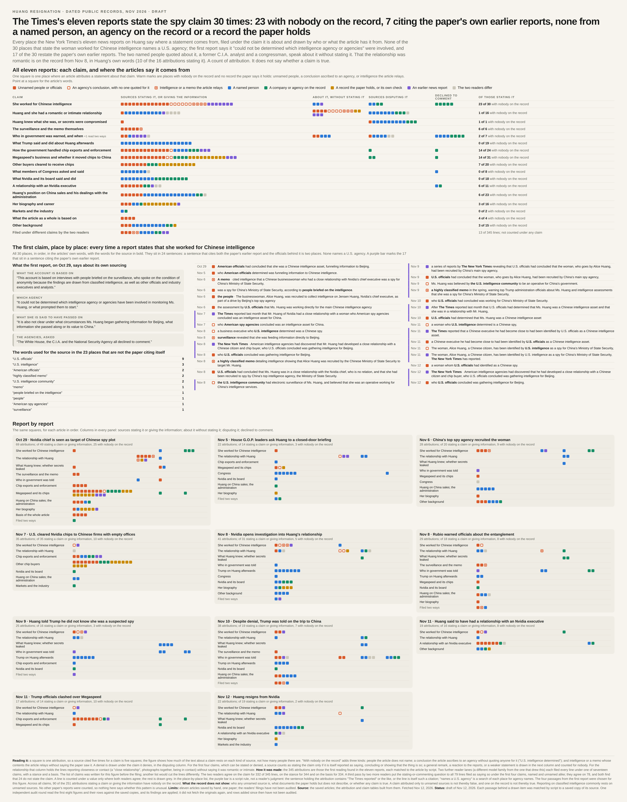

# Claims and their sources: the New York Times's eleven reports on Jensen Huang

**Status: draft, not audited.** A script has matched every quoted passage to the saved article it comes from. No independent
auditor has checked the readers' judgments (which claim a line belongs to, what kind of source it is). Nothing here says
whether any claim is true.



The figure is also here as [HTML](figures/nv12-claims-and-their-sources.html) (point at a square to read the article's
words) and [JPG](figures/nv12-claims-and-their-sources.jpg).

## What it counts

Between Oct 29 and Nov 12, 2026 the New York Times published eleven news reports on Jensen Huang, a woman the reports
say U.S. officials concluded was working for Chinese intelligence, and his resignation from Nvidia. The figure takes every place in those reports
where an article says where a statement comes from (345 places), files each under the claim it is about, and draws it
by who or what the article has it from.

- **The claim that the woman worked for Chinese intelligence is stated 30 times.** 23 of those have nobody on the
  record: 13 unnamed people, 6 conclusions ascribed to an agency with no one quoted
  ("U.S. intelligence determined"), 4 intelligence or a memo the article relays. The other 7 are the paper
  citing its own earlier reports. None comes from a named person, an agency on the record, or a record the paper says it holds.
- None of the 30 places names a U.S. agency. The first report says it "could not be determined which intelligence
  agency or agencies have been involved". 17 of the 30 sit in a sentence that cites the paper's own earlier report.
  The 30 places sit in 24 sentences.
- Two named people are quoted about that claim, a former C.I.A. analyst and a member of Congress. Both speak about it
  without stating it, so they are counted for nobody.
- 4 attributions dispute it (the Chinese embassy's spokesman, and "China"); 5 are refusals to comment.
- **That the relationship was romantic or intimate is stated 16 times**, 10 of them by Huang himself from Nov 8 on.
  Another 16 places report closeness or contact without stating it.
- Across all seventeen claims, 90 of the 251 attributions that state a claim or give the information have nobody on the record.

## What it does not show

- Who any unnamed source is, what documents the paper holds but does not describe, or whether any claim is true.
- A claim attributed only to unnamed sources is not thereby false, and one on the record is not thereby true. Reporting on
  classified intelligence commonly rests on unnamed sources.
- Whether this pattern is unusual. No other paper's reports, and no other story, were counted.
- People. A square is one attribution: a source cited five times is five squares.

## How it was made

1. **The articles.** Eleven articles were saved by hand from the paper's site as PDFs on Nov 12, 2026, and their text layers
   extracted (no OCR). Addresses and hashes are in [`links.tsv`](links.tsv).
2. **First reading: every attribution.** Two reader lanes independently listed every place an article says where a statement
   comes from, each with the article's words for the source and a passage of at most 35 words (`lanes/origin1a`, `origin1b`).
   A script kept a line only if its passage is in the article. The first reading's 345 lines are the units of the figure;
   the second reading is kept beside it as a check (`research/sourcing_times_a.tsv`, `_b.tsv`, `_compare.tsv`). Both
   lanes closed "incomplete" over one sentence of the first report that runs across a page break in the saved PDF.
3. **Second pass: claim, stance, basis.** Two more lanes each filed all 345 lines under one of seventeen claims, with a
   stance (says so, disputes, declined to comment) and a basis in eight values (`lanes/clm1a`, `clm1b`). The list of
   claims was written for this figure before the filing; another list would cut the lines differently. The readers agree
   on the claim for 332 of 345 lines, the stance for 344, the basis for 334.
4. **Third pass: stating a claim, or speaking about it.** An earlier draft counted two named commentators as sources for
   the spy claim. Two more lanes then put a states-or-comments question to all 79 lines filed as "saying so" under the
   four claims that can be stated or denied, named and unnamed alike (`lanes/clm2a`, `clm2b`). They agree on 78; both
   find that 24 do not state the claim. Those are drawn in their own column and counted for nobody.
5. **The rule, fixed before each pass reported:** a line counts under a claim, a basis, a stance or as stating a claim only
   where both readers give the same value. Everything else is drawn grey as "the two readers differ".
6. **Script rules, not reader judgments:** whether a sentence cites the paper's own earlier report, whether a place names
   a U.S. agency, and which sentence holds each place (`scripts/claims_merge.py`). The four passages from the first report
   shown beside the list were chosen for the figure (`scripts/rows_claimlines.py`).

The reader lanes ran GPT-6.1 Sol through Codex with no network access; each lane's brief, the lines it was given, its
output and its own report are in `lanes/`. The figure, the scripts and this file were drafted with Claude, a model made by
Anthropic, a company with its own interests in chip-export policy. The readings the figure rests on were made by a
different company's model, and every passage can be checked against the articles.

## The articles

| Date | Headline | By |
|---|---|---|
| Oct 29 | [Nvidia Chief, Jensen Huang, Is Seen as Target of Chinese Spy Plot](https://www.nytimes.com/2026/10/29/us/politics/nvidia-china-jensen-huang-trump.html) | Jonathan Swan, Maggie Haberman, Ana Swanson, Paul Mozur, Tripp Mickle and Julian E. Barnes |
| Nov 5 | [House G.O.P. Leaders Ask Nvidia’s Huang to Speak in Closed-Door Briefing](https://www.nytimes.com/2026/11/05/technology/house-republicans-nvidia-jensen-huang-china.html) | Tripp Mickle |
| Nov 6 | [China’s Top Spy Agency Recruited Woman Who Targeted Jensen Huang](https://www.nytimes.com/2026/11/06/us/politics/chinese-spy-agency-nvidia-jensen-huang.html) | Julian E. Barnes, Tripp Mickle, Paul Mozur and Maggie Haberman |
| Nov 7 | [U.S. Cleared Nvidia Chips to Chinese Firms With Empty Offices and Troubling Ties](https://www.nytimes.com/2026/11/07/business/economy/nvidia-chips-chinese-firms.html) | Ana Swanson, Kalley Huang and Keith Bradsher |
| Nov 8 | [Nvidia Opens Investigation Into Jensen Huang’s Relationship With Suspected Chinese Spy](https://www.nytimes.com/2026/11/08/technology/nvidia-investigation-jensen-huang-china.html) | Tripp Mickle, Maggie Haberman, Jonathan Swan, Julian E. Barnes and Ana Swanson |
| Nov 8 | [Rubio Warned Officials About Nvidia Chief’s Entanglement With Chinese Spy](https://www.nytimes.com/2026/11/08/us/politics/rubio-nvidia-ceo-chinese-spy.html) | Maggie Haberman, Jonathan Swan, Julian E. Barnes and Tripp Mickle |
| Nov 9 | [Nvidia CEO Jensen Huang Told Trump He Did Not Know Chinese Woman Was Suspected Spy](https://www.nytimes.com/2026/11/09/us/politics/trump-jensen-huang-spy.html) | Luke Broadwater and Maggie Haberman |
| Nov 10 | [Despite Denial, Trump Was Told on Trip to China About Spying on Nvidia’s Jensen Huang](https://www.nytimes.com/2026/11/10/us/politics/trump-china-trip-nvidia.html) | Maggie Haberman, Jonathan Swan, Julian E. Barnes, Ana Swanson and Tripp Mickle |
| Nov 11 | [Jensen Huang Said to Have Had Relationship With Nvidia Executive Who Reports to Him](https://www.nytimes.com/2026/11/11/technology/jensen-huang-nvidia-affair.html) | Ryan Mac, Tripp Mickle and Georgia Gee |
| Nov 11 | [Trump Officials Clashed Over Megaspeed, Firm at Heart of Nvidia Affair](https://www.nytimes.com/2026/11/11/business/economy/nvidia-affair-spy-bessent-lutnick.html) | Ana Swanson and Tripp Mickle |
| Nov 12 | [Jensen Huang Resigns From Nvidia After Affairs](https://www.nytimes.com/2026/11/12/technology/nvidia-jensen-huang.html) | Tripp Mickle and Maggie Haberman |

## The article texts are not here

The articles are the paper's. This copy holds their addresses, the hashes of the copies the figure was built from, and
the quoted passages: short runs of at most 40 words each, which together cover 36 to 49 percent of each article's text
(longest unbroken run: 1,555 characters). To check the passages yourself, save your own copy of each article's text as
`research/primary/<article id>/text.txt` and run:

```
python3 scripts/check_passages.py     # every passage found in its article? (exit 2 while texts are missing)
python3 scripts/claims_merge.py       # rebuild research/claims_lines.tsv from the lanes' output
```

## Rebuild the figure

```
pip install playwright pillow && playwright install chromium
python3 scripts/build_nv12.py         # writes figures/nv12-claims-and-their-sources.html, .png, .jpg
```

The figure is drawn from `research/claims_lines.tsv` alone; the article texts are not needed.

## What is in this copy

| Path | What |
|---|---|
| `figures/` | the figure as .png, .jpg, .html |
| `links.tsv` | the eleven articles: date, headline, authors, address, when saved, sha256 of the saved PDF and of its text layer |
| `research/claims_lines.tsv` | one row per attribution: both readers' claim, stance, basis and states-or-comments answer, the passages, and the script rules |
| `research/sourcing_times_a.tsv`, `_b.tsv`, `_compare.tsv` | the first and second readings of every attribution |
| `research/primary/<id>/meta.json` | how and when each article was saved; hashes; no text |
| `lanes/<lane>/` | the brief (`PROMPT.md`), the lines given (`shards/lines.jsonl`, second and third pass), the raw output (`out/*.jsonl`) and the lane's report |
| `scripts/` | the figure code, the table builder, the passage checker |

Changes made for this copy: local folder paths and a session id in the briefs and scripts were replaced; the first two
lanes also read two other articles that this figure does not use, and their lines were left out (origin1a: 77; origin1b: 74).
Nothing else was edited.

Quoted passages are from The New York Times and are reproduced here as short excerpts for analysis.
